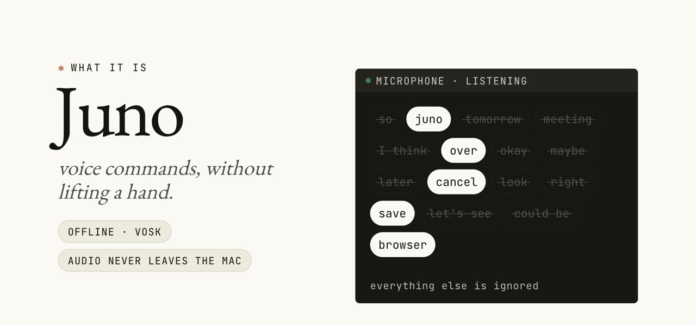

<div align="center">

# Juno

[](https://github.com/aryrabelo/juno/tags)
[](LICENSE)


**Hands-free voice commands for macOS — say a name, dictate, say a word to send. Offline, in Brazilian Portuguese or English.**

⭐ Star Juno on GitHub — it's a one-person project and every star helps.

<a href="https://youtu.be/UAH7N-d7iS0"></a>

▶️ **[Watch the video](https://youtu.be/UAH7N-d7iS0)** (English, 1:40) · [Assista em português](https://youtu.be/-C7LICcOcRU) (1:48)

</div>

## Table of contents

- [💡 The idea](#-the-idea)
- [✨ Features](#-features)
- [🎙️ Voice commands](#️-voice-commands)
- [➕ Extra shortcuts](#-extra-shortcuts)
- [📦 Install](#-install)
- [⚙️ Configuration](#️-configuration)
- [🔍 How Juno hears you](#-how-juno-hears-you)
- [🗂️ Project layout](#️-project-layout)
- [✅ Verification](#-verification)
- [🚫 Non-goals](#-non-goals)
- [🤝 Contributing](#-contributing)
- [📄 License](#-license)

## 💡 The idea

Dictation apps turn your voice into text, but you still reach for the keyboard to
start and to send. Juno closes that loop. It listens for a few command words,
and only those: say the bot's name to start dictating in
[FluidVoice](https://github.com/altic-dev/FluidVoice), talk, then say the send
word and Juno presses Enter for you.

Recognition is **offline** with [Vosk](https://alphacephei.com/vosk/) and a small
model in **Brazilian Portuguese** (`vosk-model-small-pt-0.3`) or **English**
(`vosk-model-small-en-us-0.15`) — you pick one at install. The audio never leaves
your Mac, and only the command words are recognized — everything else is ignored
as unknown.

## ✨ Features

- **Start dictation by name** — say `juno` (or any name you pick) and Juno presses
  FluidVoice's dictation shortcut.
- **Send by voice** — end with `over` (Portuguese: `câmbio`) and a short pause:
  Juno stops dictation, waits for FluidVoice to paste the text, and presses
  Enter — in any app: terminals, browsers, and Electron apps included.
- **Cancel by voice** — say `cancel` (Portuguese: `desliga`) on its own and Juno
  presses Esc.
- **Several words per command** — give the bot name or the send word as a list,
  e.g. `["juno", "june"]`, when the model mishears your first choice.
- **Safe send** — the send word only counts at the end of what you say, followed
  by silence; if you keep talking, nothing is sent.
- **Your own voice shortcuts** — say a phrase on its own and Juno presses a
  keyboard shortcut, opens an app, or runs a command. See
  [Extra shortcuts](#-extra-shortcuts).
- **Your words** — the bot name, the send word, the dictation shortcut, and your
  extra shortcuts all live in one `config.json`.
- **Start at login** — the installer can open Juno in a Terminal window on login.

> [!NOTE]
> Juno understands **Brazilian Portuguese** and **English**, one per install (the
> `language` key). Command words must exist in the Vosk model's vocabulary; the
> installer and `juno.py check-words` reject words it doesn't know.

## 🎙️ Voice commands

| You say (Portuguese / English default) | Juno does |
| --- | --- |
| **bot name** (`juno` / `juno`) | Presses the FluidVoice dictation shortcut |
| **send word** (`câmbio` / `over`), at the end, then silence | Stops dictation, waits for the paste, presses Enter |
| **stop word** (`desliga` / `cancel`), on its own | Presses Esc |

The send word presses Enter even when nothing is being dictated, in whatever
window has focus.

## ➕ Extra shortcuts

Add your own voice shortcuts under `"shortcuts"` in `config.json`: a phrase (one or
more words) and one action.

```json
"shortcuts": {
  "save": { "keys": "command+s" },
  "browser": { "open": "Safari" },
  "backup": { "run": "~/bin/backup.sh" }
}
```

| Action | What it does |
| --- | --- |
| `keys` | Presses a keyboard shortcut in the app in front, e.g. `command+s`, `control+option+.` |
| `open` | Opens (or brings to the front) an app, e.g. `Safari` |
| `run` | Runs a shell command from your home folder, without waiting for it |

A shortcut counts only when its phrase is said **on its own**, followed by a pause,
and never while dictation is running, so the same words inside a dictated message
do nothing. Every word must exist in the voice model (Juno skips a shortcut with an
unknown word and says which one); a phrase that ends with the bot name or the send
word, or that is the stop word, is skipped too. Restart Juno after editing.

### OpenBot module

For [OpenBot](https://openbot.run) users, a fourth action switches agents. It's
off until you add a shortcut that uses it:

```json
"shortcuts": {
  "next agent": { "openbot": "next" },
  "agent sales": { "openbot": "Sales · OPS" }
}
```

- `{"openbot": "next"}` brings OpenBot to the front, opens the first chat in the
  sidebar with unread replies, and focuses its message box, ready to dictate.
- `{"openbot": "<agent name>"}` opens that agent through OpenBot's ⌘K search.

Configs from before this module (`agent_word`, `next_word`, `agents`) are converted
by `./install.sh`: each `agent <nickname>` (Portuguese: `agente <apelido>`) becomes
an `openbot` shortcut, plus `agent next` and `next agent`.

## 📦 Install

### Prerequisites

- macOS with the Command Line Tools (`xcode-select --install`), which provide
  `/usr/bin/python3` and `swiftc`
- [FluidVoice](https://github.com/altic-dev/FluidVoice) with a dictation shortcut
  and **Spoken Send** set to the same send word (it removes the word from the text)

### Install Juno

```sh
git clone https://github.com/aryrabelo/juno.git
cd juno
./install.sh
```

The installer asks for the language first — **Português** or **English**, defaulting
to your Mac's language — and talks to you in it from then on. Then it creates a
Python environment, downloads that language's voice model, asks for the bot name,
the send word and the FluidVoice shortcut, and offers to start Juno at login.
Running it again is safe: it updates without touching your `config.json`, and keeps
the language you chose.

To pick the language without the question (e.g. in a script):

```sh
JUNO_LANGUAGE=en ./install.sh
```

### Try it

```sh
.venv/bin/python juno.py --test --verbose   # prints what it hears, presses nothing
.venv/bin/python juno.py                    # the real thing
```

> [!TIP]
> Grant permissions to the app that runs Juno (Terminal, if you use the login
> option): **Microphone** is asked on start, **Accessibility** is under System
> Settings › Privacy & Security, and **Automation › System Events** is asked on
> the first key press.

## ⚙️ Configuration

Everything is in `config.json`, created from `config.example.en.json` or
`config.example.pt.json`. Restart Juno after editing it. A key you leave out takes
the default of your language.

```json
{
  "language": "en",
  "wake_word": "juno",
  "send_word": "over",
  "stop_word": "cancel",
  "dictation_shortcut": "option+command+.",
  "shortcuts": {}
}
```

The Portuguese defaults are `juno` (bot name), `câmbio` (send) and `desliga` (Esc).

| Key | What it is |
| --- | --- |
| `language` | `en` (English) or `pt` (Brazilian Portuguese): picks the voice model and the default words. Missing means `pt` |
| `wake_word` | The bot's name; starts dictation. A word or a list, e.g. `["juno", "june"]` |
| `send_word` | Sends the message. A word or a list; FluidVoice removes only its own Spoken Send word from the text |
| `stop_word` | Presses Esc |
| `dictation_shortcut` | FluidVoice's shortcut, e.g. `control+option+.` |
| `shortcuts` | Your [extra shortcuts](#-extra-shortcuts): phrase → action |

Check a word before using it:

```sh
.venv/bin/python juno.py check-words friday                 # in your config's language
.venv/bin/python juno.py check-words --language pt sexta    # in another language
```

### Advanced

- `juno.py stats` summarizes recent events: what was heard, accepted or ignored
  (and why), key timings. Events go to `~/Library/Logs/Juno/events.jsonl`; only
  command words are logged, never your dictation.
- `--cmd-enter` also presses ⌘Enter after Enter, for apps that send that way.

## 🔍 How Juno hears you

- **Offline recognition** — the microphone feeds 16 kHz audio (`sounddevice`) to
  [Vosk](https://alphacephei.com/vosk/), with a small model for your language.
  Nothing leaves the Mac.
- **Follows your microphone** — Juno listens to the system's default input and
  logs its name on start. If that mic stops sending audio for 5 s (headset
  unplugged, input switched in macOS), Juno reopens the current default instead
  of going silently deaf.
- **Only command words** — Vosk gets a grammar with just your command words; any
  other speech comes out as `[unk]` and is dropped, so your dictation is never
  transcribed or stored by Juno.
- **Fast bot name** — the bot name acts on Vosk's partial result, as soon as it
  is decoded (~0.7 s sooner than waiting for the pause), with no confidence bar:
  a false start only opens dictation, and `cancel` / `desliga` closes it.
- **End of speech, enough confidence** — every other command counts only as the
  last words before a pause, with confidence 0.80. After the pause, the send
  word waits 0.3 s more and is dropped if you keep talking.
- **Send only where you dictated** — the send word presses Enter only if this
  Mac's FluidVoice is recording or stopped less than 60 s ago. With Juno on two
  Macs in the same room, both hear `over` / `câmbio`, but only the one you were
  dictating to sends.
- **FluidVoice state** — Juno reads FluidVoice's own log
  (`~/Library/Logs/Fluid/Fluid.log`) to know whether it is recording and when it
  finished pasting (or had nothing to paste).
- **Keys** — sent through `osascript` / System Events. OpenBot agent names are
  pasted (⌘V) instead of typed, so `·` and accents survive any keyboard layout.
- **`next-agent.swift`** — the OpenBot module's helper, compiled at install. It
  reads the OpenBot sidebar through the Accessibility API, opens the first chat
  showing "N new replies", and focuses its message box.

## 🗂️ Project layout

```
juno.py                  the listener
next-agent.swift         OpenBot module helper (compiled to bin/)
install.sh               setup in Portuguese or English, configuration, start at login
config.example.pt.json   default configuration in Portuguese
config.example.en.json   default configuration in English
tests/                   unit tests for the pure parts
```

## ✅ Verification

```sh
.venv/bin/python -m unittest discover -s tests
.venv/bin/python juno.py check-words juno câmbio
.venv/bin/python juno.py check-words --language en juno over
bash -n install.sh
```

## 🚫 Non-goals

- No languages other than Brazilian Portuguese and English (yet)
- No dictation of its own — Juno drives FluidVoice
- No platforms other than macOS
- No cloud: no audio or text leaves the Mac

## 🤝 Contributing

Bug reports, feature ideas, and pull requests are welcome. See
[CONTRIBUTING.md](CONTRIBUTING.md) for setup, the checks a change must pass, and
the scope this project keeps (see **Non-goals** above). Security issues: please
follow [SECURITY.md](SECURITY.md) instead of opening a public issue.

## 📄 License

[MIT](LICENSE) © Ary Rabelo
